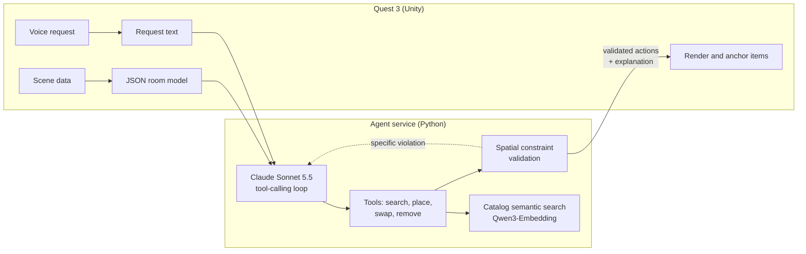

# Vignette

An AI interior decorator for mixed reality: describe a mood, and an LLM agent styles your real room on Meta Quest 3.

> **Status: in development.** Planning is done and building starts November 30, 2026. Follow progress on the [milestones](https://github.com/pbluc/Vignette/milestones) and [issues](https://github.com/pbluc/Vignette/issues), or read the full [project spec](SPEC.md).

<!-- Demo GIF goes here at the December 27 checkpoint. -->

## What it does

Put on the headset in your own room and say something like *"make this feel cozier"* or *"try a mid-century look."* Vignette's agent picks furniture and decor from a catalog, places it on your real floor, walls, and tables, explains its choices, and lets you swap or remove items by voice.

Every placement is checked against the real room before it appears: no collisions with your furniture, no blocked walkways, and no lamps floating in midair. When a placement fails, the agent is told exactly why and tries again.

I'm an interior decorator as well as a software engineer, so Vignette is built to become a tool I use in real client sessions, not only a demo.

## How it works

- **Perception:** the Unity client turns the room's scene data into a compact JSON model (surfaces, existing furniture, walkways), so the agent reasons over structure rather than raw meshes.
- **Agent:** an LLM tool-calling loop that can only change the scene through validated tools.
- **Retrieval:** semantic search over the catalog, so "something cozy for reading" finds armchairs, floor lamps, and throws.
- **Constraints:** collision, walkway, and surface rules, which return specific violations so the agent can fix them.
- **Evaluation:** a repeatable test suite of saved rooms and requests that measures placement validity, success rate, steps, latency, and cost, and compares models.
- **Observability:** every agent step is logged with its prompt version, tool calls, validation results, and token cost.

## Tech stack

| Area | Choice |
|---|---|
| Headset | Meta Quest 3, Unity, Meta XR SDK |
| Agent | Python, Claude Sonnet 5.5 (swappable through config for model comparisons) |
| Embeddings | Qwen3-Embedding, run locally |
| Hosting | AWS: ECS Express Mode on Fargate, S3, Secrets Manager |
| Infrastructure | Terraform |
| CI | GitHub Actions |

## Roadmap

| Milestone | Target | Status |
|---|---|---|
| 1. Room model: JSON room model from scene data, first placement | Dec 13, 2026 | Not started |
| 2. Agent loop: agent, tools, catalog search, constraints, 2D top-down view | Dec 27, 2026 | Not started |
| 3. End to end: voice request on the headset to anchored items | Jan 3, 2027 | Not started |
| 4. Quality: eval suite, tracing, fallbacks, prompt improvements | Jan 10, 2027 | Not started |
| 5. Showcase: hosted backend, demo video, model comparison, write-up | Jan 17, 2027 | Not started |

## How I'm building it

Vignette is built with an agentic coding workflow. The coding agent works from [`CLAUDE.md`](CLAUDE.md), which sets hard rules (for example, the model never writes scene state directly, and constraint checks are never weakened to pass a test) and splits the work: the agent takes scaffolding, tests, the eval harness, and logging, while I own the spatial math, scene data handling, constraint logic, and on-device testing. When the agent's output needs correcting, it's recorded in `docs/agent-corrections.md`. That record will become a "How I built this" section here.

## Author

**Patricia Luc** · [GitHub](https://github.com/pbluc)
